# Quantization HAR — Nhóm 3 sinh viên

Khảo sát ảnh hưởng của PTQ INT8 đến độ chính xác và dung lượng mô hình nhận diện hoạt động từ cảm biến UCI-HAR.

Toàn bộ ba phần đã được triển khai: dữ liệu/baseline FP32, PTQ full-integer
INT8 với khảo sát calibration và đánh giá–biểu đồ. Baseline đã chạy đủ 300
epoch; các kết quả lượng tử hóa trong repository là số đo từ model thật.

## Bắt đầu ngay trong VS Code

1. Giải nén ZIP; mở thư mục `quantization-har-starter` bằng File > Open Folder.
2. Mở Terminal tại thư mục có README này.
3. Chạy `python main.py --check`. Windows có thể dùng `py main.py --check` nếu lệnh python không có.
4. Đọc [phân công](PHAN_CONG_CONG_VIEC.md), điền tên thành viên và deadline.
5. Đọc [giao diện bàn giao](docs/CONTRACT.md) và tài liệu của từng giai đoạn.
6. Xem [hướng dẫn GitHub](docs/GITHUB_GUIDE.md) để đẩy toàn bộ mã nguồn đã giải nén lên repository.

## Ai viết phần nào?

| Thành viên | File chính | Kết quả bàn giao |
| --- | --- | --- |
| TV1 | `src/prepare_data.py`, `src/model.py`, `src/train.py` | Dữ liệu, cấu hình, checkpoint FP32 |
| TV2 | `src/calibration.py`, `src/quantize.py` | FP32 xuất, INT8 và cấu hình calibration |
| TV3 | `src/evaluate.py`, `src/summarize_results.py`, `src/plot_results.py` | Metric, bảng, biểu đồ và phân tích |

`src/common.py`, `configs/`, `main.py` là giao diện chung: báo cả nhóm khi thay đổi.

## Lệnh điều phối đã có sẵn

```bash
python main.py --check
python main.py --help
python main.py prepare
python main.py train
python main.py visualize-tv1
python main.py visualize-pipeline
python main.py quantize
python main.py evaluate
python main.py summarize
python main.py plot
python main.py export-c
python main.py describe-params
```

Tất cả các lệnh trên đã chạy được. Thứ tự tái lập thí nghiệm sau khi có
baseline là `quantize` → `evaluate` → `summarize` → `plot`.

`export-c` đọc `models/baseline.keras` và sinh tham số dùng trực tiếp trong
C (`firmware/include/har_resnet_params.h`, `firmware/src/har_resnet_params.c`,
golden vector kèm theo) cộng `models/params_fp32.npz` +
`models/params_manifest.json`. Xem
[hướng dẫn build/chạy C](firmware/README.md) và
[tài liệu kiến trúc + thuật toán](docs/model_architecture_and_c_inference.md).
Trong tài liệu kiến trúc, mục **1.6–1.7** là bảng tra cứu từng node: công
thức, thuật toán, parameter, code Python/C và ranh giới FP32/INT8.

`describe-params` (chạy sau `export-c`) đọc `models/params_fp32.npz` và sinh
báo cáo tham số chi tiết (vai trò, nhánh, công thức, tên biến C, thống kê
số học từng tensor) tại
[`results/parameters_reference.md`](results/parameters_reference.md).

## Môi trường nghiên cứu

Tạo môi trường riêng bằng `python -m venv .venv`. Trên Windows PowerShell, có thể gọi trực tiếp `.venv\Scripts\python.exe` mà không cần kích hoạt môi trường.

Phần TV1 đã được kiểm chứng với Python 3.10.12, TensorFlow CPU 2.16.1 và NumPy 1.26.4. Cài thư viện rồi chạy:

```bash
python -m pip install -r requirements.txt
python main.py prepare
python main.py train
```

Lệnh `prepare` tự tải UCI-HAR nếu `data/raw/UCI HAR Dataset` chưa tồn tại. Lệnh `train` dùng cấu hình trong `configs/project.json` và lưu checkpoint tốt nhất theo validation accuracy.
Lệnh `visualize-tv1` tạo bốn hình PNG trong `results/figures/tv1/` để kiểm tra dữ liệu, lịch sử huấn luyện, kiến trúc và ma trận nhầm lẫn.

Để tái lập phần lượng tử hóa và đánh giá:

```bash
python main.py quantize
python main.py evaluate
python main.py summarize
python main.py plot
```

`quantize` chỉ lấy representative data từ train. `evaluate` dùng validation
để chọn calibration size rồi mới đánh giá test, tránh dùng test để chọn cấu
hình. Xem [phương pháp lượng tử hóa](docs/quantization.md) và
[kết quả–thảo luận](docs/results_and_discussion.md).

`visualize-pipeline` tạo sơ đồ trình bày thuật toán và toàn bộ luồng xử lý tại
`results/figures/pipeline/algorithm_flow.png` (kèm bản SVG để phóng to).

Bản sơ đồ Archify chi tiết, nhiều nhánh nằm tại
`results/figures/pipeline/quantization_har_archify.html`. Mở tệp này bằng trình
duyệt để đổi giao diện sáng/tối, phóng to, trình chiếu hoặc xuất PNG/SVG. Bản
ảnh tĩnh dùng trực tiếp trong báo cáo là
`results/figures/pipeline/quantization_har_archify.png`; bản nền tối là
`quantization_har_archify_dark.png`. Nguồn sơ đồ có thể chỉnh sửa nằm tại
`docs/diagrams/quantization_har.dataflow.json`.

## Thư viện ảnh và sơ đồ

Toàn bộ ảnh kết quả và sơ đồ đã được lưu trực tiếp trong repository.
Nhấn vào từng ảnh để xem kích thước đầy đủ.

### Sơ đồ pipeline và kiến trúc

[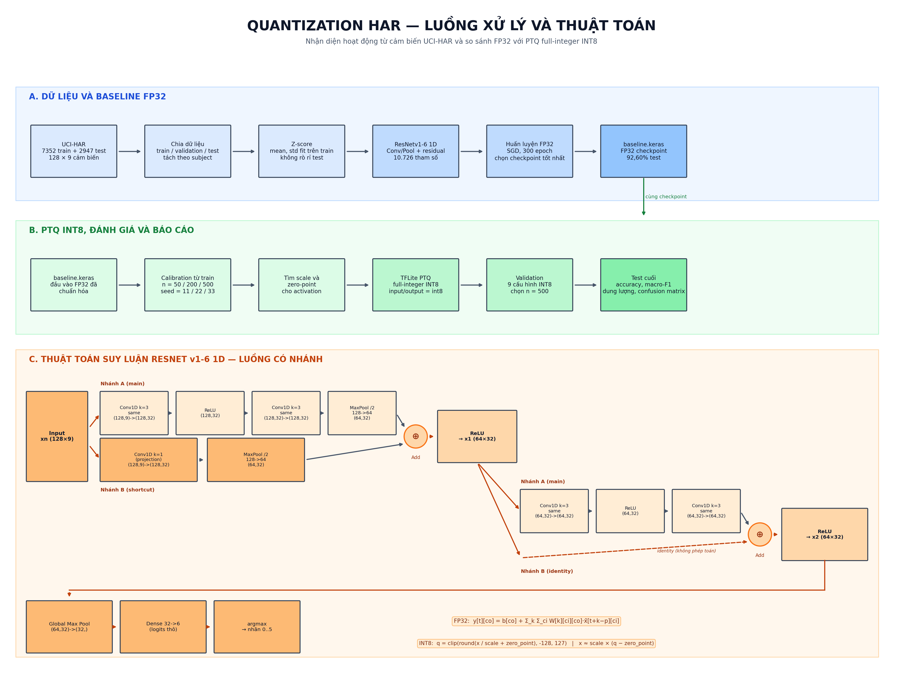](results/figures/pipeline/algorithm_flow.png)

[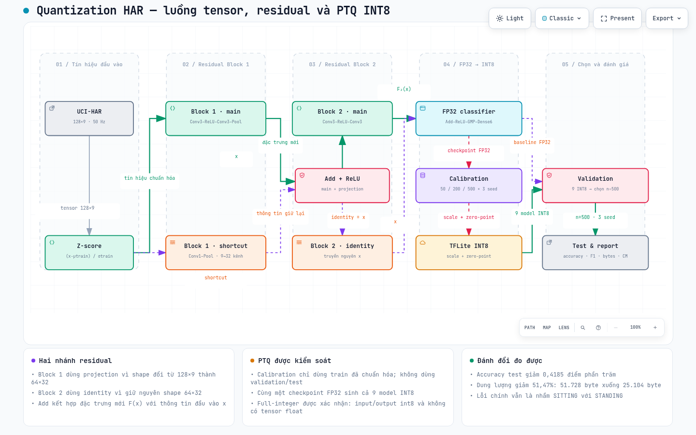](results/figures/pipeline/quantization_har_archify.png)

[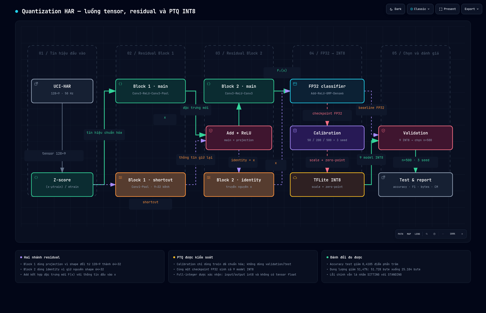](results/figures/pipeline/quantization_har_archify_dark.png)

Bản khám phá tương tác: [HTML](results/figures/pipeline/quantization_har_archify.html) ·
[SVG](results/figures/pipeline/algorithm_flow.svg) ·
[nguồn sơ đồ](docs/diagrams/quantization_har.dataflow.json)

### Kết quả baseline FP32

| Phân bố lớp | Ma trận nhầm lẫn | Kiến trúc model | Quá trình huấn luyện |
| --- | --- | --- | --- |
| [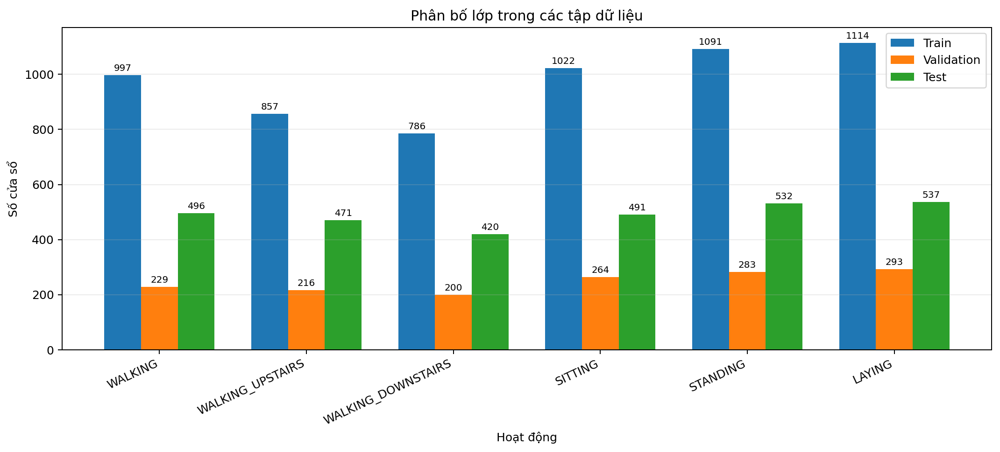](results/figures/tv1/class_distribution.png) | [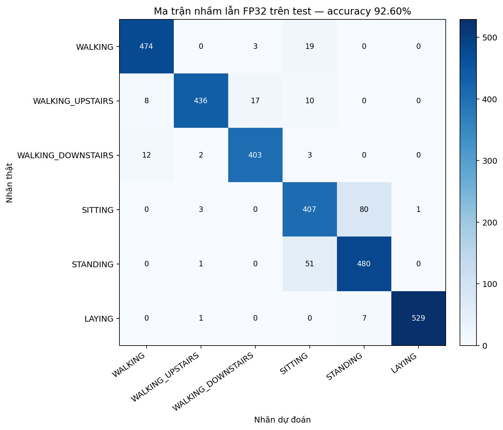](results/figures/tv1/confusion_matrix_fp32.png) | [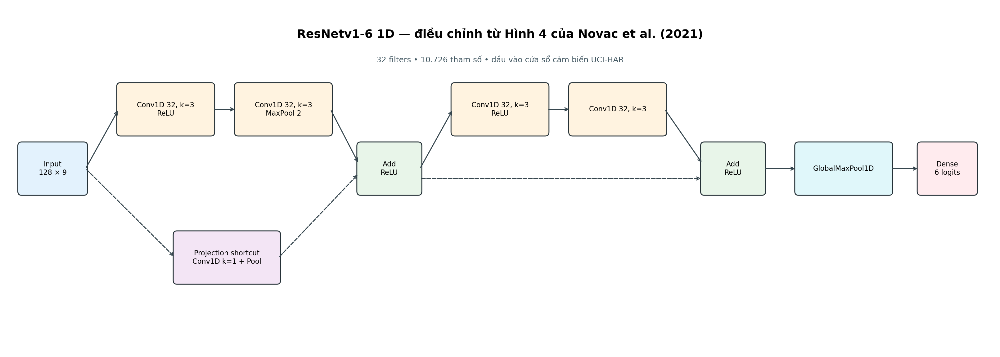](results/figures/tv1/model_architecture.png) | [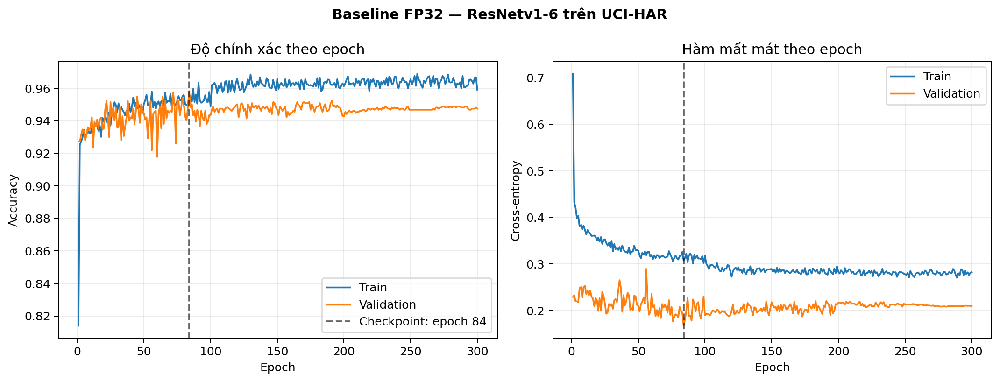](results/figures/tv1/training_curves.png) |

### Kết quả lượng tử hóa INT8

| Accuracy theo calibration | Macro-F1 theo calibration | Ma trận nhầm lẫn test | Dung lượng model |
| --- | --- | --- | --- |
| [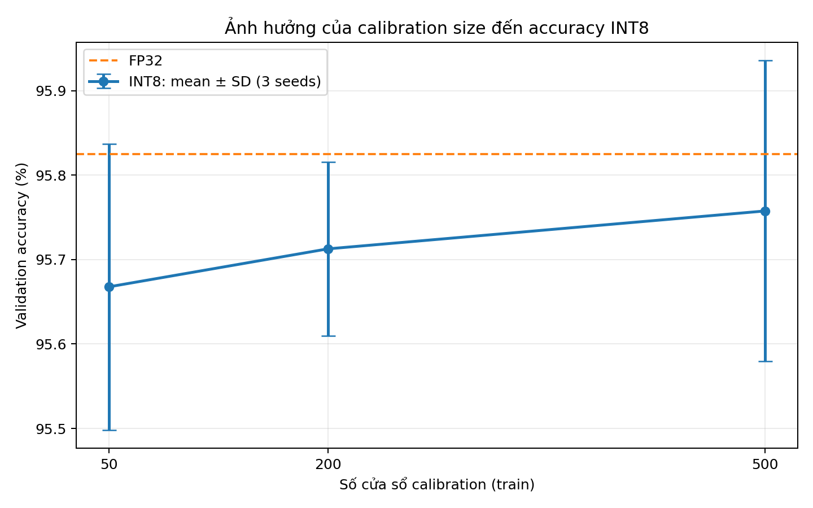](results/figures/quantization/accuracy_vs_calibration.png) | [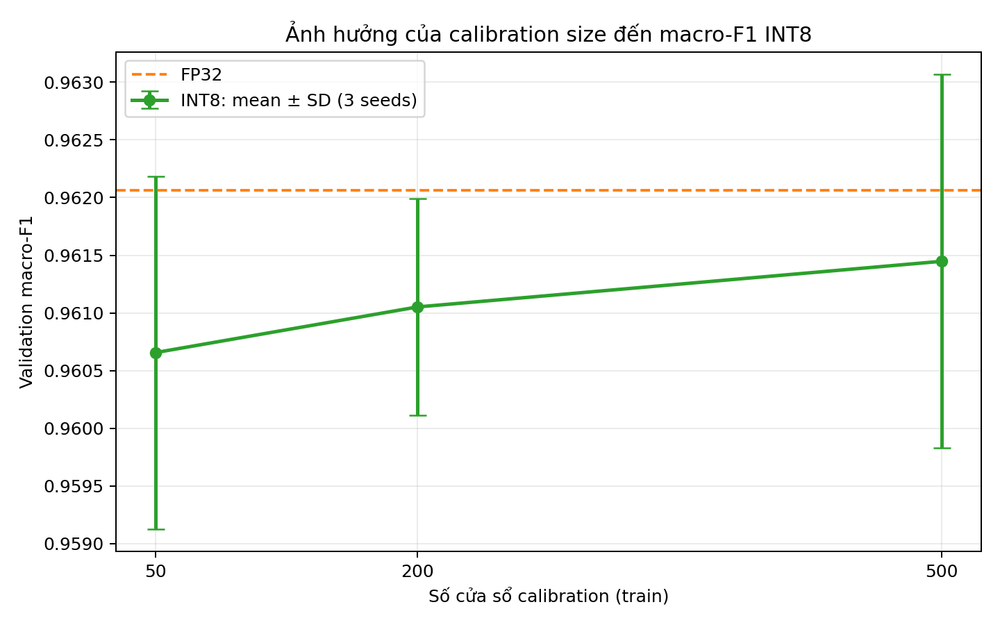](results/figures/quantization/macro_f1_vs_calibration.png) | [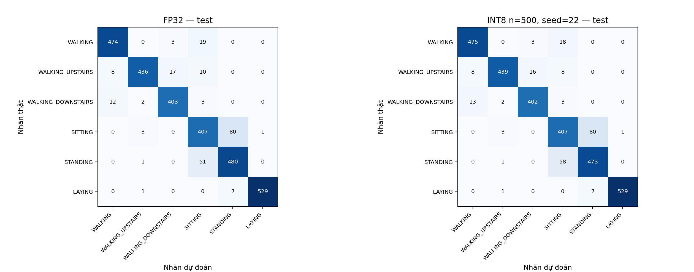](results/figures/quantization/confusion_matrix_test.png) | [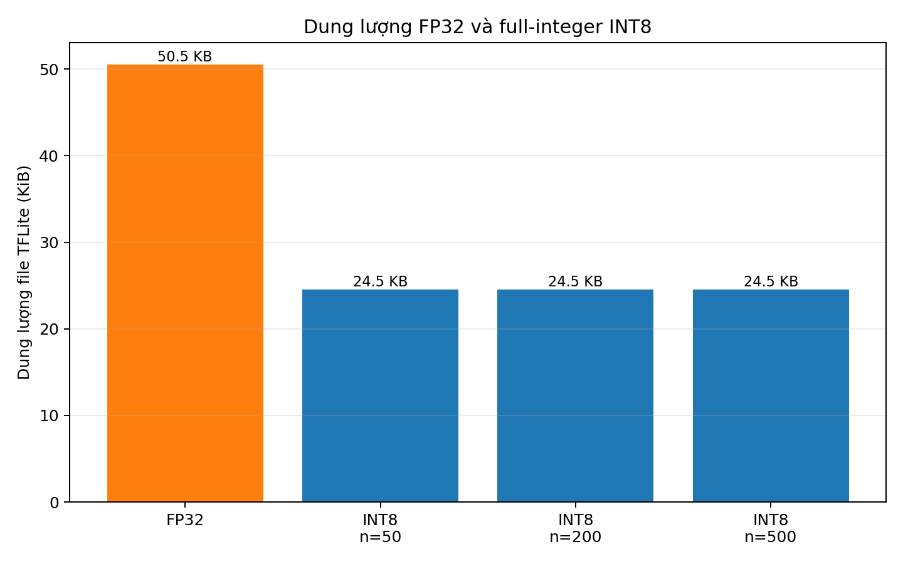](results/figures/quantization/model_size_comparison.png) |

## Phạm vi nghiên cứu

- Dataset: [UCI-HAR](https://doi.org/10.24432/C54S4K), tự tải riêng; không kèm dữ liệu trong ZIP.
- Paper nền: [Quantization and Deployment of Deep Neural Networks on Microcontrollers](https://doi.org/10.3390/s21092984).
- Một baseline FP32; INT8 PTQ; calibration 50/200/500 cửa sổ là cấu hình khảo sát đề xuất.
- Giữ nguyên checkpoint giữa các cấu hình calibration. Calibration lấy từ train; chọn cấu hình bằng validation; test dùng cuối cùng.
- So sánh accuracy, macro-F1, dung lượng file. Không suy ra RAM/Flash, năng lượng hoặc tốc độ MCU từ laptop.
- Baseline dùng ResNetv1-6 ở Hình 4 của paper, điều chỉnh Conv/Pool thành 1D cho tensor UCI-HAR `(128, 9)`, chọn 32 filters.
- Huấn luyện bám mục 6.1.1: SGD, batch 64, 300 epoch, learning rate 0,05, momentum 0,9, weight decay `5e-4`, giảm learning rate ×0,13 tại epoch 100/200/250 và Mixup.
- Khác paper: nhóm tách validation theo subject, dùng Mixup alpha 0,2 do paper không công bố alpha và khảo sát TFLite PTQ INT8 thay vì gọi đây là tái hiện nguyên bản MicroAI QAT.

## Kết quả TV1 đã đo

| Chỉ số | Kết quả |
| --- | ---: |
| Validation accuracy | 95,82% |
| Validation macro-F1 | 0,9621 |
| Test accuracy | 92,60% |
| Test macro-F1 | 0,9271 |
| Số tham số | 10.726 |
| Checkpoint `.keras` | 148.495 byte |
| Epoch được chọn | 84/300 |

Xem mô tả và giới hạn tại [docs/data_and_baseline.md](docs/data_and_baseline.md).

## Kết quả PTQ INT8 đã đo

Calibration size `500` được chọn theo mean validation accuracy qua ba seed.
Trên test, FP32 TFLite đạt `92,6026%`; INT8 đạt trung bình
`92,1841 ± 0,2722%`. File giảm từ `51.728` xuống `25.104` byte
(`51,47%`, tương đương `2,06×`). Xem bảng sinh tự động tại
[results/summary.md](results/summary.md).

## Thư mục

| Thư mục | Mục đích |
| --- | --- |
| `src/` | Mã nguồn theo từng người |
| `configs/` | Cấu hình dùng chung |
| `docs/` | Giao diện bàn giao, ghi chép paper, báo cáo |
| `data/raw/`, `data/processed/` | Dữ liệu cục bộ, không commit dữ liệu lớn |
| `models/` | Checkpoint và model xuất, không commit model lớn |
| `results/` | CSV, biểu đồ đã kiểm tra |
| `firmware/` | Suy luận C99 thuần từ baseline FP32 (`python main.py export-c` + `make test`) |
| `.github/` | Mẫu Issue, PR và CI kiểm tra bộ khung |

Xem [mốc tiến độ](docs/MILESTONES.md). CI chỉ kiểm tra cú pháp và cấu hình bộ khung, không xác nhận chất lượng nghiên cứu.
